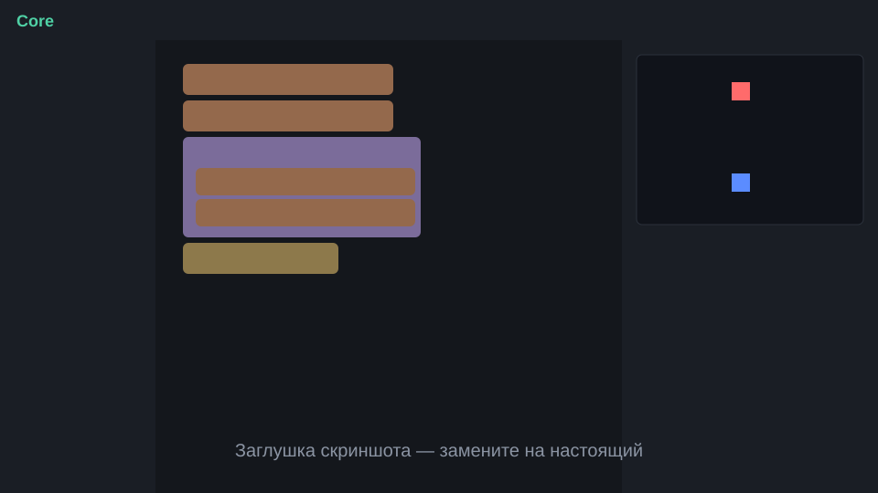

# Core

**Core** — учебный мини-язык программирования с блочным редактором на русском языке. Программу собирают из блоков, перетаскивая их мышью или касанием; рядом показывается та же программа в виде текста на языке Core.



> Скриншот-заглушка: замените `docs/screenshot.svg` на настоящий снимок экрана.

## Идея

Блоки и текст — два представления одной программы. Внутри — дерево (AST), которое выполняет интерпретатор. Редактор строит это дерево, а текст генерируется из него (только для показа; разбора текста в этой версии нет).

Язык состоит из **ядра** (оно не знает ни о каких играх) и **расширения «Мир»** — отдельной библиотеки встроенных функций поверх ядра: холст, клавиатура, таймер, случайные числа и цикл кадров. На них собрана демо-игра.

## Как запустить

Дважды щёлкните по `index.html`. Сервер, сборка и интернет не нужны — всё работает по `file://`, сторонних библиотек нет.

Проверка тестов (нужен только [Node.js](https://nodejs.org/)):

```bash
node tests/run.js
```

## Как пользоваться

1. Слева — палитра по категориям: Значения, Переменные, Условия, Циклы, Функции, Вывод, Мир.
2. Перетащите блок в рабочую область. Блоки вкладываются в «если», «повторить», «пока», функции и «каждый кадр»; значения вставляются в слоты (в занятый слот значение вставляется с заменой). Клик по блоку в палитре добавляет его в конец рабочей области.
3. Удалить блок: перетащите его обратно в палитру или выделите и нажмите **Delete**.
4. **▶ Запуск** выполняет программу, **■ Стоп** останавливает цикл кадров, **↺ Сбросить** очищает вывод и холст. «Упорядочить» расставляет стопки блоков друг под другом.
5. Справа — холст, панель вывода и вкладка «Текст программы».
6. В списке «Пример» — две готовые программы.

Если при выполнении возникает ошибка, она показывается по-русски с номером блока (например, «Ошибка в блоке №4: Деление на ноль.»); сам блок подсвечивается красным.

## Возможности

**Ядро**
- Типы: число, текст, логическое значение.
- Переменные: `переменная x = 0`, `присвоить x = 5`, `изменить x на 1` (прибавляет к значению).
- Арифметика и сравнение: `+ − × / остаток`, `= ≠ < > ≤ ≥`, `и`, `или`, `не`. Текст склеивается плюсом.
- Условия `если … то … иначе`, циклы `повторить N раз` и `пока`.
- Функции: `функция имя(параметры)`, `вернуть`, рекурсия, вызов как значения и как оператора.
- Вывод: `показать`.
- Ошибки времени выполнения на русском с номером блока.
- Лимит шагов интерпретатора защищает от зависания (понятная ошибка вместо «вечного» цикла).

**Расширение «Мир»**
- `холст(ширина, высота)`, `очистить(цвет)`, `прямоугольник(x, y, ширина, высота, цвет)`, `надпись(...)`, `надпись_по_центру(...)`.
- `клавиша("влево" | "вправо" | "вверх" | "вниз" | "пробел")` — стрелки и WASD, пробел.
- Блок «каждый кадр» — выполняется примерно 60 раз в секунду.
- `таймер()`, `случайное(от, до)`, `целое(x)`.
- Цвета — названия («синий», «красный», «белый», «серый», «фон»…) или коды `#rrggbb`.

**Редактор**
- Перетаскивание мышью и касанием, вложение блоков, подсветка места вставки.
- Подсветка выполняющихся блоков, подсветка блока с ошибкой.
- Тёмная тема, системный шрифт, один акцентный цвет; работает от ширины 1024 px.

## Демо

1. **Сумма от 1 до 10** — выводит `55`.
2. **Мини-шутер Core** — вид сверху, один раунд на 30 секунд. Синие (вы) против красных (бот). Стрелки или WASD — движение, **пробел** — выстрел в ту сторону, куда вы смотрите. У каждой стороны 5 единиц здоровья; пули — точки, попадание — проверка попадания точки в прямоугольник (функция `попал`, собранная из блоков). Таймер раунда, счёт, экран конца раунда. Игра собрана только из блоков ядра и «Мира» — игровых блоков в ядре нет.

## Тесты

`tests/run.js` запускает программы Core из `tests/cases/` и сверяет вывод. Проверяются: сумма 1–10, арифметика, условия, циклы, функции и рекурсия, ошибки (деление на ноль, неизвестные имена, типы), лимит шагов, генерация текста, библиотека «Мир» (с поддельным холстом), реестр блоков редактора и сами демо-программы (включая игру на тысячи кадров).

## Устройство

```
index.html            страница
css/style.css         оформление
src/core/             ядро: ast.js · interpreter.js · codegen.js
src/world/            расширение «Мир»: world.js · blocks.js
src/editor/           редактор: spec.js · blocks-core.js · render.js · editor.js
src/demos/            примеры
src/app.js            сборка интерфейса
tests/                тесты
```

Правила проекта — в [CLAUDE.md](CLAUDE.md).

## План развития

- Разбор текста Core в дерево (двусторонняя связь «блоки ↔ текст»).
- Списки и словари, чтобы в игре было много пуль и врагов.
- Сохранение и загрузка программ (файл и localStorage), экспорт в JSON.
- Пошаговое выполнение и отладчик с просмотром переменных.
- Отмена и повтор действий, копирование и вставка блоков, масштаб рабочей области.
- Звук, спрайты и столкновения в «Мире»; разные раунды и уровни.
- Объявление функций с типами и подсказками прямо в блоках.

## Лицензия

[MIT](LICENSE)
